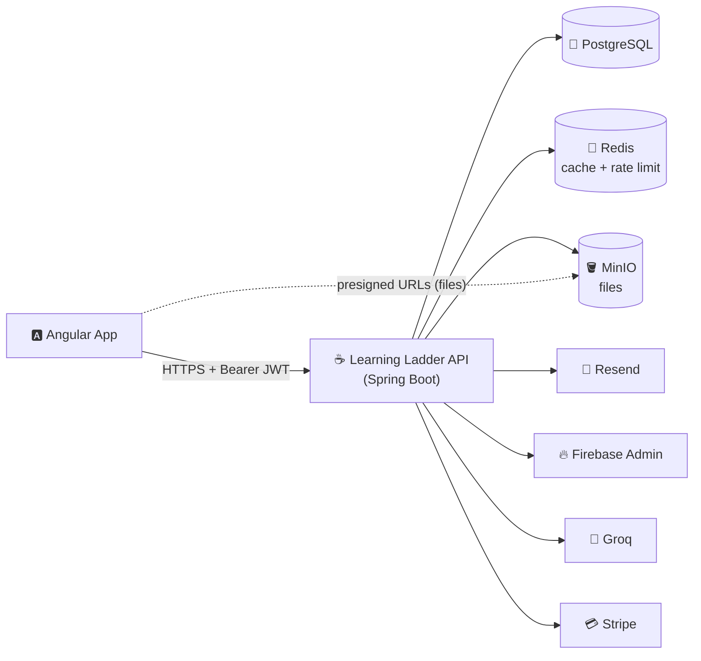

<div align="center">

# 🪜 Learning Ladder Develop and Maintain By Asoh Yannick, Java Full Stack Developer.
### The all-in-one School Management System REST API

*Manage students, tutors, courses, timetables, payments, libraries and more, from a single secure backend.*


</div>

---

## 📑 Table of Contents

- [🎯 About the Project](#-about-the-project)
- [✨ Major Features](#-major-features)
- [🧱 Tech Stack](#-tech-stack)
- [🏗️ Architecture & Project Structure](#️-architecture--project-structure)
- [🔐 Authentication & Authorization](#-authentication--authorization)
- [🅰️ Angular Frontend Integration](#️-angular-frontend-integration)
- [🚀 Getting Started (Developer Onboarding)](#-getting-started-developer-onboarding)
- [🐳 Running with Docker](#-running-with-docker)
- [📚 API Documentation](#-api-documentation)
- [🧑‍💻 Developer Guide & Conventions](#-developer-guide--conventions)
- [✅ New Developer Checklist](#-new-developer-checklist)
- [🧪 Testing](#-testing)
- [🛠️ Troubleshooting](#️-troubleshooting)
- [🔒 Security Rules](#-security-rules)
- [🤝 Contributing](#-contributing)

---

## 🎯 About the Project

**Learning Ladder** is a School Management System. This repository contains its **Spring Boot REST API**, the backend that powers every feature of the platform. The user interface is a separate **Angular** application that consumes this API.

### 🌟 Objectives

| | Objective |
|---|---|
| 🏫 | **Digitise school operations**: admissions, courses, timetables, library, finance and staff in one place |
| 👥 | **Serve every role**: executives, academic staff, finance, HR, exam officers, students, tutors and parents |
| 🔐 | **Keep data safe**: authenticated by default, role-based access, hashed passwords, private file storage |
| ⚡ | **Stay fast**: Redis caching, rate limiting, background email processing |
| 🤝 | **Connect learners and tutors**: bookings, reviews, job listings and AI-assisted learning |

---

## ✨ Major Features

### 📦 Business Modules

| Icon | Module | What it covers |
|:---:|---|---|
| 👤 | **Users & Roles** | Accounts for 30+ school roles, account status (unverified, verified, blocked), profile data |
| 🎓 | **Student Profiles** | Student information and academic profile management |
| 🧑‍🏫 | **Tutor Profiles** | Tutor information, expertise and availability |
| 📚 | **Courses** | Course catalogue and course management |
| 🗓️ | **Timetables** | Class and schedule management |
| 📅 | **Bookings** | Booking and scheduling of sessions |
| 📖 | **Library** | Library resources and management |
| 💳 | **Payments** | Fees and online payments (Stripe) |
| 🛒 | **Shopping Cart** | Cart for purchasable school items and courses |
| ⭐ | **Reviews** | Ratings and feedback |
| 💼 | **Job Listings & Applications** | Publish vacancies and receive applications |
| 🤖 | **AI Assist** | AI-powered help using the Groq API |
| 📁 | **File Storage** | Documents, images and videos stored in MinIO, never in the database |

### ⚙️ Platform Features

| Icon | Feature | Details |
|:---:|---|---|
| 🔑 | **JWT authentication** | Short-lived access tokens and long-lived refresh tokens, sent as `Authorization: Bearer <token>` |
| 🔥 | **Firebase login** | Users can sign in with Firebase; the API verifies the Firebase ID token and issues its own JWTs |
| 📧 | **OTP and email flows** | Email verification, resend OTP, forgot or reset password, magic-link login, account blocked or unblocked notices |
| 🎨 | **Branded HTML emails** | Colour-coded email templates per action, sent through Resend in the background |
| 🧠 | **Redis caching** | Read-only queries are cached for **5 minutes**; the next request after expiry goes to the database |
| 🚦 | **Rate limiting** | **500 requests per minute per IP**, backed by Redis |
| 🗂️ | **Presigned file URLs** | Files in MinIO are served through presigned URLs valid for **7 days**, stored in the database and refreshed automatically |
| 🌱 | **User seeding** | Default accounts are created from environment variables on first start, only once |
| 📘 | **Swagger / OpenAPI** | Interactive API docs with a built-in "Authorize" button for Bearer tokens |
| 🩺 | **Actuator** | Health and info endpoints, other endpoints restricted to admins |

---

## 🧱 Tech Stack

### ☕ Backend

| Technology                      | Purpose |
|---------------------------------|---|
| **Java 25**                     | Language (virtual threads enabled) |
| **Spring Boot 4.1.x**           | Application framework (Web, Validation, Actuator, Cache) |
| **Spring Data JPA / Hibernate** | ORM and repositories |
| **Spring Security**             | Stateless, authenticated-by-default security |
| **JJWT**                        | Access and refresh token generation and validation |
| **BCrypt**                      | Password hashing |
| **Flyway**                      | Database migrations |
| **springdoc-openapi**           | Swagger UI and OpenAPI docs |
| **Lombok**                      | Boilerplate reduction |
| **Maven (wrapper)**             | Build tool, use `./mvnw`, no local Maven needed |

### 🗄️ Data & Infrastructure

| Technology | Purpose |
|---|---|
| 🐘 **PostgreSQL** | Primary relational database |
| 🔴 **Redis** | Caching (5-minute TTL) and per-IP rate limiting |
| 🪣 **MinIO (S3-compatible)** | Object storage for documents, images and videos |
| 🐳 **Docker & Docker Compose** | Containerised build and local environment |

### 🔌 Third-Party Integrations

| Service | Purpose |
|---|---|
| 📧 **Resend** | Transactional emails (OTP, password reset, notifications) |
| 🔥 **Firebase Admin SDK** | Verifying Firebase ID tokens for Firebase login |
| 🤖 **Groq API** | AI features (OpenAI-compatible chat completions) |
| 💳 **Stripe** | Payments |

### 🅰️ Frontend (separate repository)

| Technology | Purpose |
|---|---|
| **Angular** | Single-page application that consumes this REST API |
| **Firebase Web SDK** | Client-side sign-in that produces the ID token sent to this API |

---

## 🏗️ Architecture & Project Structure



### 📂 Folder Layout

```text
src/main/java/com/learningLadder/learningLadder
├── 🔧 config/                    # Cross-cutting configuration
│   ├── apiResponse/              # APISuccessResponse and APIErrorResponse
│   ├── backgroundJob/            # Async jobs: user seeder, fire-and-forget emails
│   ├── cachingConfig/            # Redis cache manager (5-minute TTL)
│   ├── corsConfig/               # Global CORS
│   ├── firebaseAdminConfig/      # Firebase Admin SDK + ID token verifier
│   ├── jwtConfig/                # Token generation and validation
│   ├── jwtFilter/                # JWT authentication filter
│   ├── minioConfig/              # MinIO clients + file upload service
│   ├── openAIConfig/             # Groq (OpenAI-compatible) client
│   ├── ratingLimiting/           # Redis rate limiter (500 req/min/IP)
│   ├── resendConfig/             # Resend client, EmailService, email templates
│   ├── secuirtyConfig/           # Spring Security filter chain
│   └── swaggerConfig/            # OpenAPI / Swagger setup
├── 🌐 controller/                # REST controllers (thin, HTTP only)
├── 📨 dto/                       # Request and response objects
├── 🗃️ entity/                    # JPA entities by module (user, course, booking, ...)
├── 🔢 enums/                     # UserRole, AccountStatus, FileCategory, ...
├── ⚠️ exception/                 # Custom exceptions + global exception handler
├── 🔁 mappers/                   # Entity <-> DTO mapping
├── 🗄️ repository/                # Spring Data repositories by module
├── 🧠 service/                   # Business logic
└── 🧰 utils/                     # Helpers
src/main/resources
├── application-{dev,staging,prod,test}.yaml
└── db/migration                  # Flyway SQL migrations
```

---

## 🔐 Authentication & Authorization

🔒 **Every request must be authenticated by default.** Only the following are public:

| Public path | Purpose |
|---|---|
| `/api/{version}/auth/**` | Register, login, OTP, password reset, magic link, Firebase login, refresh |
| `/swagger-ui/**`, `/v3/api-docs/**` | API documentation (disabled in production) |
| `/actuator/health`, `/actuator/info` | Health checks |

### 🔄 Token flow

```text
1. Login (password, magic link or Firebase)  ->  access token + refresh token
2. Call the API with   Authorization: Bearer <accessToken>
3. Access token expires  ->  401 with errorCode "TOKEN_EXPIRED"
4. Use the refresh token to get a new access token
```

- Access and refresh tokens use **separate secrets**, and each carries a `type` claim so a refresh token can never be used as an access token.
- Token lifetimes are set with `JWT_ACCESS_TOKEN_EXPIRATION_MS` and `JWT_REFRESH_TOKEN_EXPIRATION_MS`.

### 🔥 Firebase login

```text
Angular signs in with Firebase  ->  gets a Firebase ID token  ->  sends it to the API
API verifies the token with Firebase Admin  ->  matches it to a Learning Ladder user
API returns its own JWT access + refresh tokens
```

### 👥 Roles

Accounts are role-based and protected with method security (`@PreAuthorize`).

| Group | Roles |
|---|---|
| 🏛️ Executive | Super Admin, Admin, IT Admin, Vice Chancellor, Deputy Vice Chancellor |
| 📋 Records | Registrar, Deputy Registrar, Student Registrar, Admissions Officer, Admission Committee |
| 🎓 Academic leadership | Academic Director, Dean, Deputy Dean, Head of Department, Deputy Head of Department |
| 🧑‍🏫 Teaching | Professor, Lecturer, Assistant Lecturer |
| 💰 Finance | Bursar, Accountant, Finance Officer |
| 🧑‍💼 HR | HR Manager, HR Officer |
| 📝 Exams | Examination Officer, Results Officer |
| 🧑‍🎓 Student services | Librarian, Student Affairs Officer, Counselor |
| 👪 Family | Parent |

---

## 🅰️ Angular Frontend Integration

The **Angular** app talks to this API over HTTPS and JSON.

### 1️⃣ Base URL and CORS

- Use the API base `http://localhost:<PORT>/api/<API_VERSION>` locally.
- The API only accepts browser calls from origins listed in `CORS_ALLOWED_ORIGINS`, for example `http://localhost:4200`.

```properties
CORS_ALLOWED_ORIGINS=http://localhost:4200,https://app.yourschool.com
ALLOWED_METHODS=GET,POST,PUT,PATCH,DELETE,OPTIONS
```

### 2️⃣ Attach the token with an HTTP interceptor

```ts
// auth.interceptor.ts
export const authInterceptor: HttpInterceptorFn = (req, next) => {
  const token = inject(AuthService).accessToken();
  return next(token ? req.clone({ setHeaders: { Authorization: `Bearer ${token}` } }) : req);
};
```

On a `401` with `errorCode: "TOKEN_EXPIRED"`, call the refresh endpoint once, then retry the original request.

### 3️⃣ Firebase sign-in from Angular

```ts
const credential = await signInWithPopup(auth, new GoogleAuthProvider());
const idToken = await credential.user.getIdToken();
this.http.post(`${API}/auth/firebase`, { idToken }).subscribe(/* store the API tokens */);
```

### 4️⃣ Response format

✅ **Success**

```json
{
  "success": true,
  "status": 200,
  "message": "Student retrieved successfully",
  "data": { },
  "path": "/api/v1/students/12",
  "timestamp": "2026-11-07T15:50:12.123Z"
}
```

❌ **Error**

```json
{
  "success": false,
  "status": 404,
  "error": "Not Found",
  "errorCode": "STUDENT_NOT_FOUND",
  "message": "Student with id 12 not found",
  "path": "/api/v1/students/12",
  "timestamp": "2026-11-07T15:50:12.123Z"
}
```

Validation failures also include an `errors` array with `field`, `message` and `rejectedValue`.

### 5️⃣ Files, images and videos

Files never pass through the database. The API returns a **presigned URL** (valid for 7 days) that Angular can use directly, for example in `` or `<video [src]>`. When a URL is close to expiry, the API generates a new one automatically the next time the resource is fetched.

### 6️⃣ Codes the frontend should handle

| Status | Meaning |
|---|---|
| `401` | Missing, invalid or expired token (`TOKEN_EXPIRED`, `TOKEN_INVALID`, `UNAUTHORIZED`) |
| `403` | Authenticated but not allowed (`ACCESS_DENIED`) |
| `429` | Rate limit exceeded, read the `Retry-After` header |

Every response also carries `X-RateLimit-Limit`, `X-RateLimit-Remaining` and `X-RateLimit-Reset` headers.

---

## 🚀 Getting Started (Developer Onboarding)

### 📋 Prerequisites

| Tool | Version | Notes |
|---|---|---|
| ☕ JDK | **25** | Check with `java -version` |
| 🐳 Docker Desktop | Latest | For PostgreSQL and Redis (and the containerised API) |
| 🔧 Git | Latest | |
| 💡 IntelliJ IDEA | Latest | Enable the **Lombok** plugin and **annotation processing** |
| 🪣 MinIO or compatible S3 server | Running on port 9000 | Needed for file uploads |
| 🅰️ Node.js + Angular CLI | LTS | Only if you also work on the frontend |

> 💡 You do **not** need Maven installed. Use the included wrapper: `./mvnw` (macOS/Linux) or `mvnw.cmd` (Windows).

### 🪜 Step by step

**1️⃣ Clone the repository**

```bash
git clone https://github.com/asohyannick/learningLadder.git
cd learningLadder
```

**2️⃣ Create your environment file**

```bash
cp env.example .env          # Windows (PowerShell): copy env.example .env
```

Open `.env` and fill in every value (see the table below). The application imports `.env` from the project root automatically, so you do not need to export variables by hand.

**3️⃣ Start PostgreSQL and Redis**

```bash
docker compose up -d postgres redis
```

**4️⃣ Make sure MinIO is running**, and that `MINIO_*` values in `.env` match it.

**5️⃣ Run the API**

```bash
./mvnw spring-boot:run       # Windows: mvnw.cmd spring-boot:run
```

On first start, Flyway creates the database schema and the seeder creates the default accounts.

**6️⃣ Verify it works**

| Check | URL |
|---|---|
| 🩺 Health | `http://localhost:<PORT>/actuator/health` |
| 📘 Swagger UI | `http://localhost:<PORT>/swagger-ui.html` |

**7️⃣ Log in with a seeded account** using the email and password you put in `.env` (for example `SUPER_ADMIN_EMAIL_ADDRESS` and `SUPER_ADMIN_PASSWORD`), then click **Authorize** in Swagger and paste your access token.

### 🔧 Environment variables

| Group | Variables |
|---|---|
| 🌐 Server | `PORT`, `API_VERSION`, `SPRING_PROFILES_ACTIVE` (`dev`, `staging`, `prod`, `test`) |
| 🐘 PostgreSQL | `PG_DATABASE_HOST`, `PG_DATABASE_PORT`, `PG_DATABASE_NAME`, `PG_DATABASE_USERNAME`, `PG_DATABASE_PASSWORD` |
| 🔴 Redis | `REDIS_HOST`, `REDIS_PORT`, `REDIS_PASSWORD` |
| 🔑 JWT | `JWT_ACCESS_TOKEN`, `JWT_REFRESH_TOKEN` (Base64 secrets, at least 32 bytes each), `JWT_ACCESS_TOKEN_EXPIRATION_MS`, `JWT_REFRESH_TOKEN_EXPIRATION_MS` |
| 🌍 CORS | `CORS_ALLOWED_ORIGINS`, `ALLOWED_METHODS` (comma-separated) |
| 🚦 Rate limit | `RATE_LIMIT_ENABLED`, `RATE_LIMIT_REQUESTS_PER_MINUTE` (default 500) |
| 🪣 MinIO | `MINIO_ENDPOINT`, `MINIO_PORT`, `MINIO_USE_SSL`, `MINIO_REGION`, `MINIO_USERNAME`, `MINIO_PASSWORD`, `MINIO_BUCKET_NAME`, `MINIO_CONSOLE_PORT`, `MINIO_AUTO_CREATE_BUCKET`, `MINIO_PUBLIC_ENDPOINT` |
| 📧 Resend | `RESEND_API_KEY`, `RESEND_SENDER_EMAIL`, `RESEND_SENDER_NAME` |
| 🔥 Firebase | `FIREBASE_PROJECT_ID`, `FIREBASE_PRIVATE_KEY_ID`, `FIREBASE_PRIVATE_KEY`, `FIREBASE_CLIENT_EMAIL`, `FIREBASE_CLIENT_ID` |
| 🤖 Groq | `GROQ_API_KEY`, optional `GROQ_MODEL` |
| 💳 Stripe | `STRIPE_API_KEY` |
| 🌱 Seeded users | `<ROLE>_EMAIL_ADDRESS` and `<ROLE>_PASSWORD` for each role, for example `ADMIN_EMAIL_ADDRESS` / `ADMIN_PASSWORD` |

> 🔥 **Firebase private key:** put it on a **single line** with literal `\n` between the lines, and no quotes.

### 🌱 About seeded users

- The default accounts are created from the `app.bootstrap.users` section once the application has started.
- A user is created **only if its email does not exist yet**, so restarting never duplicates users or resets passwords.
- Passwords are **BCrypt-hashed** before they reach the database, and seeded accounts are created as **verified**.

---

## 🐳 Running with Docker

```bash
docker compose up -d --build        # build the image and start everything
docker compose logs -f api          # follow the API logs
docker compose down                 # stop (add -v to also delete the data volumes)
```

- The **Dockerfile** is a multi-stage build on **Java 25** (JDK to build, JRE to run), runs as a **non-root** user and has a health check.
- `.env` is **never** copied into the image; Docker Compose injects it at runtime.
- Inside Docker, the API reaches PostgreSQL and Redis by service name (`postgres`, `redis`).

---

## 📚 API Documentation

| Resource | URL |
|---|---|
| 📘 Swagger UI | `/swagger-ui.html` |
| 📄 OpenAPI JSON | `/v3/api-docs` |

1. Log in and copy the **access token**.
2. Click **🔓 Authorize** in Swagger UI and paste the token (without the `Bearer ` prefix).
3. Every request from Swagger now includes the token.

> ⚠️ Swagger is **disabled in production**.

---

## 🧑‍💻 Developer Guide & Conventions

### 🧭 Layering

```text
Controller  ->  Service  ->  Repository  ->  Database
   (HTTP)     (business)     (data access)
```

- 🎛️ **Controllers** are thin: validate input, call a service, return `APISuccessResponse`.
- 🧠 **Services** hold the business logic.
- 📨 **Never return JPA entities** from controllers. Map to DTOs, because entities contain password hashes, OTPs and tokens.
- ⚠️ **Errors** go through the global exception handler and are returned as `APIErrorResponse`.

### ⚡ Caching

- Put `@Cacheable` on **service** read methods, never on controllers.
- Cache DTOs, not entities, and don't cache Spring's `Page<T>`; map it to your own paged DTO.
- Include **every parameter that changes the result** in the cache key (page, size, user id for per-user data).
- Use the names in `CacheNames`, and evict with `@CacheEvict` on write methods.

### 📁 Files and media

- Upload through `MinioFileStorageService`. **Never store files in PostgreSQL.**
- Return files with `resolveUrl(...)`, which refreshes expired presigned URLs.
- The bucket stays **private**.

### 📧 Emails

- Send emails in the background with `FireAndForgetEmailAsync`, using the templates in `ResendEmailTemplateAsync`.
- Pass plain values (strings), not entities, into the background task.
- Emails sent inside a `@Transactional` method go out only **after the transaction commits**.

### 🤖 AI

- Use `GroqChatClient`. Do not send personal student or staff data to the AI service.
- Treat AI output as untrusted text.

### 🗃️ Database changes

- Schema changes go in a **new Flyway migration**: `V<next>__short_description.sql`.
- ❌ Never edit a migration that has already been merged.
- Hibernate runs in `validate` mode, so an entity change without a migration fails at startup.

### 🌿 Git workflow (suggested)

| Branch | Purpose |
|---|---|
| `main` | Production-ready code |
| `develop` | Integration branch |
| `feature/<short-name>` | New features |
| `fix/<short-name>` | Bug fixes |

Commit style: `feat: add tutor booking endpoint`, `fix: correct OTP expiry check`, `docs: update README`.

### ✅ Pull request checklist

- [ ] The project builds and tests pass
- [ ] New endpoints appear correctly in Swagger
- [ ] Entities are not exposed; DTOs are used
- [ ] A Flyway migration is included for every schema change
- [ ] No secrets, tokens or personal data are logged or committed
- [ ] Access rules are set (`@PreAuthorize` where roles matter)

---

## ✅ New Developer Checklist

### 📅 Day 1

- [ ] Install JDK 25, Docker Desktop, Git and IntelliJ (with the Lombok plugin)
- [ ] Get access to the repository and the team's secrets vault
- [ ] Create your `.env` from `env.example`
- [ ] Run PostgreSQL and Redis, then start the API
- [ ] Open Swagger and log in with a seeded account

### 📅 Week 1

- [ ] Read through `config/` to understand security, JWT, caching and rate limiting
- [ ] Read one complete module end to end (entity, repository, service, controller)
- [ ] Make a small change on a `feature/` branch and open your first pull request
- [ ] Connect the Angular app locally and sign in through it

---

## 🧪 Testing

```bash
./mvnw test                 # Windows: mvnw.cmd test
```

- Use the `test` profile (`SPRING_PROFILES_ACTIVE=test`).
- Disable external integrations in tests: `app.bootstrap.enabled=false`, `app.rate-limit.enabled=false`, `app.firebase.enabled=false`.
- Mock `EmailService`, `GroqChatClient` and `FirebaseTokenVerifier` so tests never send real emails or call external APIs.

---

## 🛠️ Troubleshooting

| Problem | Likely fix |
|---|---|
| ❌ `Could not resolve placeholder 'XYZ'` | A variable is missing in `.env`, compare it with `env.example` |
| ❌ Lombok errors on JDK 25 | Use a Lombok version of 1.18.40 or newer and enable annotation processing |
| ❌ `401` on every request | Missing `Authorization: Bearer <token>` header, or the token has expired |
| ❌ CORS error in the browser | Add the Angular origin to `CORS_ALLOWED_ORIGINS` |
| ❌ Uploads fail with a size error | Check `spring.servlet.multipart` limits and the file category limits |
| ❌ File links don't open in the browser | Check `MINIO_PUBLIC_ENDPOINT`; it must be reachable from the browser |
| ❌ Schema validation fails at startup | An entity changed without a Flyway migration |
| ❌ `429 Too Many Requests` | Per-IP rate limit reached, wait for `Retry-After` seconds |
| ❌ Firebase key is rejected | Make the key a single line with literal `\n` and no quotes |

---

## 🔒 Security Rules

- 🚫 **Never commit `.env`** or any secret. It is in `.gitignore` and `.dockerignore`.
- 🔑 Use **long, unique secrets** for JWT, database and seeded accounts, and rotate them if exposed.
- 🪪 **Never log** passwords, tokens, OTP codes, presigned URLs or personal data.
- 🔗 A presigned URL is a **password in link form**: anyone holding it can open the file until it expires.
- 🧼 Escape user-provided text before putting it into HTML or emails.
- 🛡️ Keep the MinIO bucket private and Swagger off in production.

---

## 🤝 Contributing

1. 🍴 Create a branch from `develop`: `git checkout -b feature/my-feature`
2. 💻 Make your changes following the conventions above
3. ✅ Run the tests
4. 📬 Open a pull request and request a review

---

<div align="center">

### 🪜 Learning Ladder: climbing together, one step at a time

**Maintainer:** Asoh Yannick &nbsp;|&nbsp; 📄 **License:** to be defined by the project owner

</div>